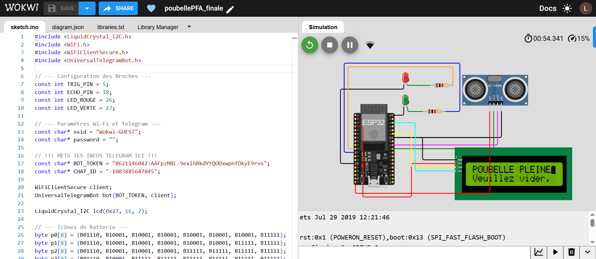
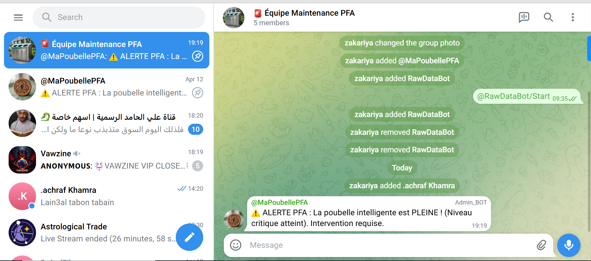

# Smart Compression Trash Bin (PFA)

Solar-powered smart trash bin that compresses waste automatically and alerts the maintenance team via Telegram when it is full.

## Features
- Fill-level detection with an HC-SR04 ultrasonic sensor
- Automatic compression cycle (state machine: waiting → compression → piston return → level analysis → bin full)
- 16x2 I2C LCD with a battery-style fill icon
- Red / green LEDs showing piston down / up
- Wi-Fi + Telegram bot alert when the bin is full
- Solar power supply

## Hardware
ESP32, HC-SR04 ultrasonic sensor, 16x2 I2C LCD, red and green LEDs with resistors.

## Simulation
Run it online on Wokwi: (https://wokwi.com/projects/461031015465139201)

## Screenshots

## Setup
1. Copy `firmware/secrets.example.h` to `firmware/secrets.h`
2. Fill in your own Telegram bot token and chat ID
3. Upload `firmware/poubelle_pfa.ino` to the ESP32 (or run it in Wokwi)

## Repository structure
- `firmware/` – ESP32 code
- `simulation/` – Wokwi project files
- `cad/` – 3D design (Onshape)
- `Docs/` – report, specifications, user guide

## Author
Lamfataa Zakariya – ENSA El Jadida, Electrical & Energy Engineering
